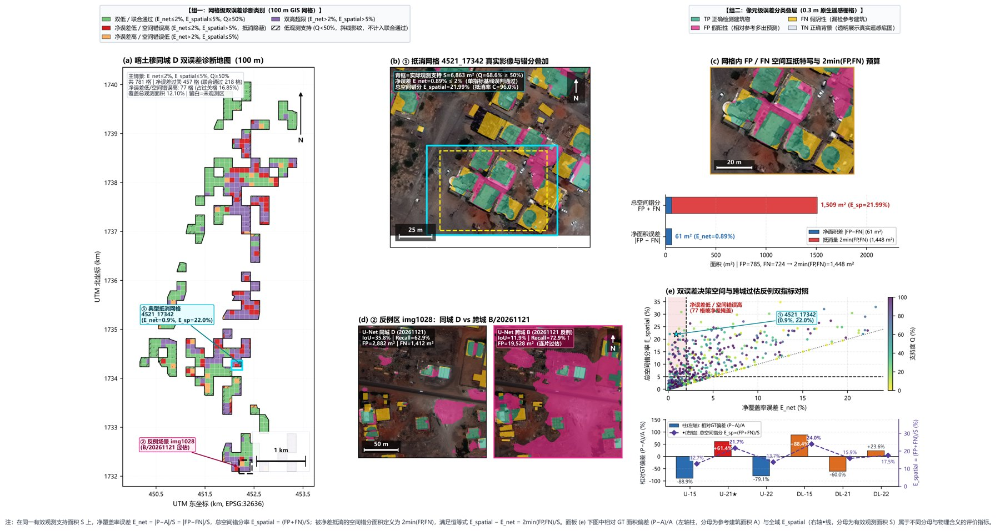
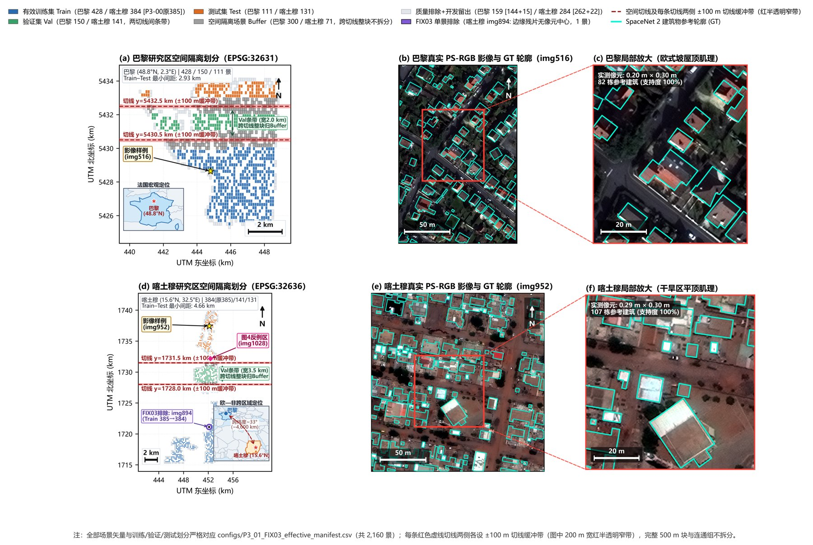
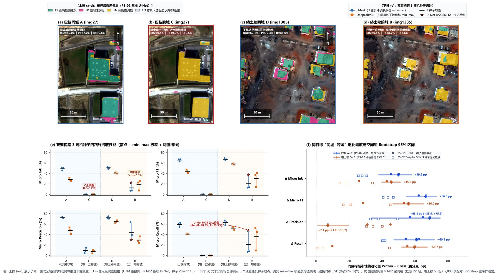
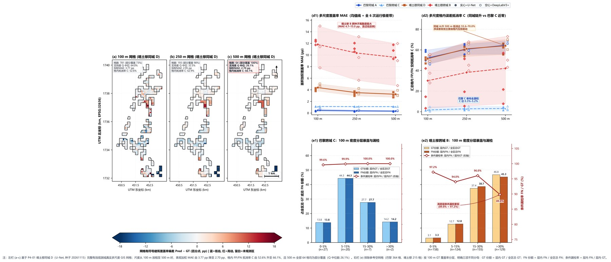
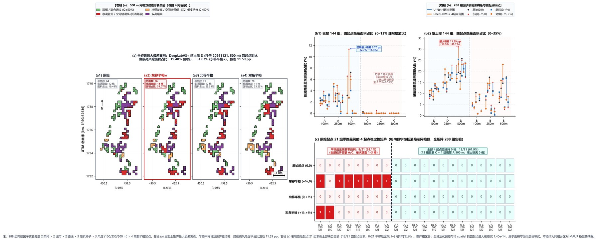

# Cross-city Building Extraction and GIS Spatial Reliability

**When building area looks right, the map can still be wrong.** This research follows
Paris–Khartoum segmentation errors into multi-scale GIS statistics and tests how
grid origins change the diagnosis.

Project author: **薛梦乐 (Mengle Xue)**, sole manuscript author and corresponding author.
This repository accompanies a Chinese research working manuscript; it is not a
peer-reviewed publication. The English author spelling is subject to author approval
before formal publication. No institutional endorsement or funding is claimed.



*Figure 4. False positives and false negatives can cancel in an area total while
retaining substantial spatial error. Imagery/annotations: SpaceNet Partners.*

## Research question and contribution

Does pixel-level building extraction accuracy tell us whether aggregated building
area is spatially reliable? The study connects fixed bidirectional transfer tests,
unique observed support, FP/FN area budgets and grid-origin sensitivity. It uses
established segmentation and disagreement concepts; it does not introduce a new
segmentation network or claim that quantity/position disagreement is a new concept.

## Study design



| Design component | Frozen setting |
|---|---|
| Public data | SpaceNet 2 Paris and Khartoum training-area imagery and building GeoJSON |
| Effective train / validation / test scenes | Paris 428 / 150 / 111; Khartoum 384 / 141 / 131 |
| Models | U-Net (width 8); DeepLabV3+ (MobileNetV2 width 0.5), no pretrained weights |
| Seeds | 20261115, 20261121, 20261122 |
| Routes | A: Paris→Paris; B: Paris→Khartoum; C: Khartoum→Paris; D: Khartoum→Khartoum |
| Training | 12 epochs; Adam; batch 4; source-only P1/P99 normalization; validation-only checkpoint selection |
| GIS matrix | 2 architectures × 3 seeds × 4 routes × 3 scales × 4 origins = 288 combinations |
| Diagnostic scenarios | 27 threshold combinations per GIS combination |

The frozen manifest retains quality exclusions, whole spatial groups, buffer and
development holdouts. FIX03 excludes only `AOI_5_Khartoum_img894` from effective
training because its tiny edge geometry has unresolved building semantics and no
pixel-center rasterization. It is not relabeled as background.

## Recorded results

The following ranges are the three recorded seed results, not confidence intervals.
Source: [paired route metrics](results/P5_02/tables/architecture_paired_route_metrics.csv).

| Model | A IoU (%) | B IoU (%) | C IoU (%) | D IoU (%) |
|---|---:|---:|---:|---:|
| U-Net | 45.65–50.15 | 6.81–22.60 | 0.09–0.22 | 48.59–52.42 |
| DeepLabV3+ | 25.73–30.80 | 7.43–25.28 | 0.10–0.11 | 39.68–41.66 |



Transfer is directionally asymmetric. Khartoum→Paris approaches complete omission;
Paris→Khartoum area bias can change sign across seeds and architectures. Cross-city
underestimation is therefore not universal.



Net area error can shrink as spatial errors cancel inside larger cells. Report both
`E_net = |FP−FN|/S` and `E_spatial = (FP+FN)/S`, together with observed fraction
`Q = S/L²` and cancellation `C = 1−|FP−FN|/(FP+FN)` (undefined if there is no error).



These are descriptive, reference-label-dependent diagnostics on observed test
support. They do not establish unlabelled deployment reliability, independent
ground-truth accuracy, causal mechanisms or a population-wide city ranking.

## Quick start

Use Python 3.11 and run commands from this repository root:

```bash
python -m venv .venv
# Activate .venv using your platform's activation command.
python -m pip install -r requirements.txt
python -m pytest -q tests
python scripts/smoke.py --output runs/smoke
```

The smoke test uses synthetic disk GeoTIFF/GeoJSON inputs, updates both actual
models, reloads checkpoints, infers native outputs and checks GIS support
conservation. It does not need SpaceNet data or existing weights. Output directories
must be new; existing results are preserved.

**Verification status:** clean Python 3.11 virtual-environment installation and
`pip check` passed; 9 targeted tests and the actual two-model synthetic smoke passed.
All 2,160 real scenes passed asset-hash checks and bitwise Support-array regeneration.
Five main figures and three supplements were regenerated from the packaged recorded
inputs. The GIS export regenerated 1,440 main-scenario rows from all 288 recorded
cell tables, matching their numeric reference columns. These checks do not constitute
a fresh full rerun of the 12 formal models. See [BUILD_STATUS](docs/BUILD_STATUS.md).

## Full reproduction

Acquire the public products described in [Data availability](docs/DATA_AVAILABILITY.md),
then use an external data directory:

```bash
python -m src.pipeline prepare --data-root /path/to/SpaceNet2 --work runs/full
python scripts/reproduce.py --work runs/full --stage train
python scripts/reproduce.py --work runs/full --stage evaluate
python scripts/reproduce.py --work runs/full --stage gis
```

These are real command-line entry points; the three formal stages are intentionally
explicit. They are resource-intensive and are not run during installation.
[Reproduction guide](docs/REPRODUCE.md) covers individual routes, outputs, formal
figures and current verification limits. [Methods](docs/METHODS.md) defines the
fixed protocol; [Expected results](docs/EXPECTED_RESULTS.md) identifies reference tables.

## Repository layout

| Path | Purpose |
|---|---|
| `src/` | Extracted numerical core, actual models, native inference, Support and GIS routines |
| `scripts/` | Full experiment orchestration, smoke test and original formal plot layouts |
| `configs/` | Portable frozen manifests, original hyperparameters and four derived label repairs |
| `tests/` | Error identities, inclusive thresholds, support conservation, splits and checkpoint ties |
| `results/` | Recorded result tables and selected derived plotting assets |
| `figure_inputs/` | Only the derived GIS layers used by Figure 1 |
| `figures/` | Five original main figures, three supplements, and compressed README previews |
| `paper/` | Author-corrected public Chinese manuscript and supplement (PDF and Markdown) |
| `docs/` | Methods, provenance, reproduction, acceptance status and license boundaries |

## Paper and supplementary material

- [Chinese manuscript PDF](paper/完整中文期刊风格工作稿.pdf) · [Markdown](paper/完整中文期刊风格工作稿.md)
- [Supplement and reproduction notes PDF](paper/补充材料与复现说明.pdf) · [Markdown](paper/补充材料与复现说明.md)
- [Formal figures](figures/) · [Source mapping](docs/PROVENANCE.json)

The public papers omit the author's private email. ORCID, city and postal code remain
unfilled. Editable DOCX files are retained locally and excluded from Git tracking.

## Data, citation and licensing

Original remote-sensing data and checkpoints are not included. Obtain data from the
[official SpaceNet 2 page](https://spacenet.ai/spacenet-buildings-dataset-v2/).
SpaceNet imagery/labels and adapted figure panels carry the publisher's CC BY-SA 4.0
terms and attribution obligations. Vendored U-Net retains its original MIT license.

Use [CITATION.cff](CITATION.cff) for this research software. No journal, DOI or other
authors are invented. The top-level [MIT License](LICENSE) applies only to Mengle
Xue's original software code. The manuscript, supplement, SpaceNet imagery and
annotations, derived media containing third-party material, and third-party code
retain their own terms; details and dependency license metadata are in
[license scope](docs/LICENSE_STATUS.md) and [dependency licenses](docs/DEPENDENCY_LICENSES.md).
The repository is maintained under GitHub account `xy0125423`.
