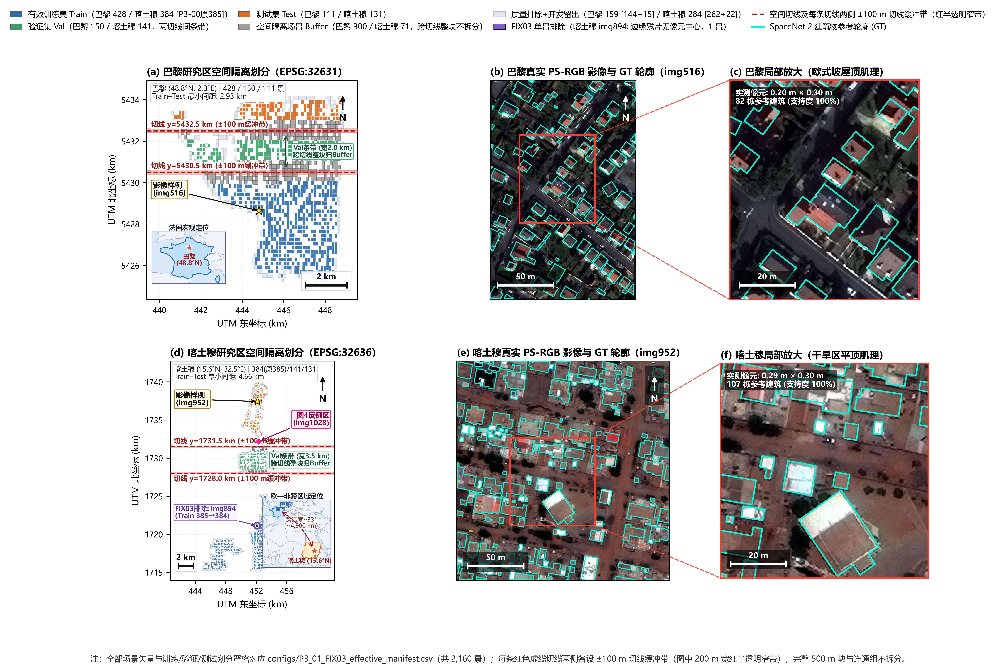

# 跨城市建筑物提取误差的GIS统计后果与网格起点敏感性

@authors Mengle Xue*
@affiliation 测绘地理信息学院；城市、邮政编码：[待填写]；ORCID：[待填写]

@abstract 建筑物提取精度能否反映下游GIS统计可靠性，取决于误差在空间聚合中的表现。基于SpaceNet 2巴黎与喀土穆影像及建筑物标注，在空间隔离划分下，采用U-Net和DeepLabV3+及3个随机种子，比较双向跨城预测在100、250和500 m网格中的面积偏差、空间错分与四种半格起点敏感性。结果表明，两类架构均发生方向非对称的跨城退化；喀土穆迁移至巴黎持续近全漏检，而反向迁移的面积偏差随种子和架构跨越零点。聚合尺度增大使同城覆盖率误差下降，却同时增强假阳性与假阴性的格内抵消。主情景下，基线喀土穆同城净误差通过网格中，仍有16.85%—23.81%存在超限空间错分；更高IoU与更小绝对面积偏差也可伴随更大的总空间错分。仅平移网格起点，500 m标记面积占比的四起点极差最高达11.59个百分点，21组原始起点零标记组合中有8组转为非零。结果说明，净面积一致性不足以代表空间位置一致性，局部诊断还受网格分区与观测支持约束。跨区域建筑物GIS评价应联合报告数量与空间错分，检验起点敏感性，并明确参考标签依赖和部分观测域的推断边界。

@keywords 建筑物提取；跨城市迁移；GIS空间可靠性；数量分歧；空间错分；FP/FN抵消；可变空间单元问题；观测支持

## 1 引言

建筑物足迹支撑城市空间分析、基础地理信息更新与灾害暴露度评估[1–3]。深度学习与公开基准促进了高分辨率建筑物自动制图[4–6]，但模型输出进入地理信息系统（GIS）后，往往被转换为网格建筑面积、覆盖率及其空间分布。像元分类精度与这些下游统计之间并非一一对应：提取错误既可能改变建筑总量，也可能在总量接近时保留较大的位置错分。因此，建筑物产品评价需要同时回答“提取是否准确”与“聚合后的统计是否可靠”。

跨城市应用为考察这一关系提供了典型情境。建筑形态、地表背景和成像条件的差异会削弱源域模型的目标域泛化能力[7–10]。现有研究已从异常对象检测、多源域适应、形状与位置先验、不确定性估计及数据增强等方面改善目标域提取[11–17]。这些工作主要解决精度提升问题，而固定模型的跨城错误如何转化为GIS面积偏差，以及这种转化是否随迁移方向和训练随机性变化，仍需在明确空间支持的条件下加以检验。

误差评价理论已为此提供基础。单一全局指标难以完整描述分类错误的空间结构[18,19]。数量分歧与分配分歧的区分[20]，以及交换、位移分歧的进一步分解[21]，说明预测与参考总量接近并不意味着位置一致。空间显式建成区评价也已将局部精度、数量一致性与尺度敏感性联系起来[22–24]。本文据此采用净覆盖率误差和总空间错分率描述建筑物面积预算，不将数量与位置分离宣称为新概念。

空间聚合还受到可变空间单元问题（modifiable areal unit problem，MAUP）的约束：单元尺度和边界位置均可改变局部统计[25–28]。与此同时，面积评价必须明确参考数据质量、抽样设计和观测总体[29,30]。在不完整观测的规则网格中，未观测部分不能作为零覆盖参与分母。因而，仅报告某一尺度、某一起点上的低净误差，尚不足以证明局部GIS统计可靠。

本文以SpaceNet 2巴黎与喀土穆为对象，在双架构、三随机种子和空间隔离划分下，考察跨城误差向多尺度GIS统计传导的过程。研究依次检验双向迁移的精度与面积偏差、格内假阳性（FP）与假阴性（FN）的抵消，以及固定预测场下四种半格起点对局部诊断的影响。既有研究已使用SpaceNet多城市数据开展建筑物提取[31]；本文的增量在于将配对跨城评价、场景去重的唯一观测支持、双误差预算和起点敏感性纳入同一实证链条，而非提出新的分割网络或建立城市总体精度排名。

## 2 数据与研究方法

### 2.1 研究区与有效样本

采用SpaceNet 2巴黎和喀土穆的RGB-PanSharpen三波段融合影像及GeoJSON建筑物标注[1,6]。官方AOI面积与标签数量分别为约1,030 km²、23,816个和约765 km²、35,503个，均不等同于本文有效样本规模。研究区及样本划分见图1，有效样本构成见表1。

@figure 1 巴黎与喀土穆研究区、空间隔离划分及影像示例。（a、d）样本分区与地理定位；（b、c、e、f）真实影像、参考建筑轮廓及局部放大。

@table 1 有效样本构成与空间隔离距离
| 项目 | 巴黎 | 喀土穆 |
|---|---|---|
| 本地资产场景数 | 1,148 | 1,012 |
| 质量排除场景数 | 144 | 262 |
| 隔离缓冲／开发留出／单景排除 | 300／15／0 | 71／22／1 |
| 训练／验证／测试场景数 | 428／150／111 | 384／141／131 |
| 训练／验证／测试空间组数 | 88／29／22 | 120／37／55 |
| 训练／验证／测试空标签场景数 | 28／130／85 | 16／0／10 |
| 训练—验证最小距离（m） | 975.5 | 970.6 |
| 训练—测试最小距离（m） | 2,926.5 | 4,659.1 |
| 验证—测试最小距离（m） | 975.5 | 970.6 |
@note 空标签指提供的GeoJSON不含建筑要素；不等同于经人工核实地表无建筑。样本流向与影像元数据全表见补充表S5，空间组细目见补充表S6。

两城影像均为650×650像元、uint16类型，坐标参考系为WGS84（EPSG:4326），文件头未显式定义NoData。经纬度步长均为2.7×10⁻⁶°，但实测东西向与南北向地面像元尺寸在巴黎为0.1974—0.1976 m×0.3003 m，在喀土穆为0.2894—0.2896 m×0.2988 m。因此，原生面积采用WGS84椭球逐行测地线计算，GIS聚合分别采用UTM投影EPSG:32631和EPSG:32636，不能将标称0.30 m的平方直接视为两城真实像元面积。

### 2.2 标签、观测支持与空间划分

建筑多边形转换至影像坐标系后，以像元中心落入多边形为准栅格化；缺失显式坐标参考信息的标注按CRS84处理。有效观测掩膜结合RGB、PAN、多光谱融合及原生多光谱产品的零值连通组件与内部掩膜，区分边缘填充、保守有效支持、不确定边界和无效像元，仅保守有效支持参与训练与评价。场景准入要求该类像元占比不低于80%；完整判定规则见补充材料S6。

喀土穆一景训练标签的边缘残片虽与7个像元有非零面积相交，却未覆盖任何像元中心，且影像证据不足以确认建筑语义。该景从有效训练中排除，使训练样本由385景降至384景，验证和测试样本保持不变；原始标签与影像未修改。

考虑空间自相关可能导致验证偏乐观[32–34]，按完整500 m空间块划分训练、验证和测试区，重叠场景与重复连通组不拆分，并在地理切线两侧各设100 m缓冲。切线根据坐标、样本平衡和历史开发留出确定，未依据测试表现或标签密度选择。两城跨分区空间组、RGB及非空标签哈希交集均为0，隔离距离见表1。空间隔离测试用于描述固定划分下的外推表现，不等价于城市总体的概率抽样精度估计[35,36]。

评价路线固定为A（巴黎→巴黎）、B（巴黎→喀土穆）、C（喀土穆→巴黎）和D（喀土穆→喀土穆）。A与C共享巴黎测试集，D与B共享喀土穆测试集；所有跨城测试均沿用源域模型、归一化参数与分类阈值。

### 2.3 模型训练与配对评价

采用轻量U-Net[37]与DeepLabV3+[38]，后者使用MobileNetV2-0.5编码器[39]。共同训练设置及结构差异见表2。两模型容量相差3.06倍，因此比较反映给定容量和训练预算下的架构族差异，不属于等参数消融。

@table 2 模型与训练设置
| 配置 | U-Net | DeepLabV3+ |
|---|---|---|
| 可训练参数量 | 486,553 | 1,490,689 |
| 结构设置 | 基础通道8，编码—解码跳接 | MobileNetV2-0.5；输出步长16；ASPP空洞率6、12、18；解码器128通道 |
| 输入与输出 | 3通道输入，1通道输出 | 3通道输入，1通道输出 |
| 训练输入 | 128×128；无预训练 | 128×128；无预训练 |
| 优化设置 | Adam，学习率0.001；批量4；12轮 | Adam，学习率0.001；批量4；12轮 |
| 随机种子 | 20261115、20261121、20261122 | 20261115、20261121、20261122 |
@note 两模型均无数据增强、学习率调度与早停，使用CPU 4线程确定性模式。完整配置与训练记录见补充表S7、S3和S8，资源开销见补充图S1。

输入影像双线性缩放，标签最近邻缩放，有效掩膜采用自适应平均池化后不低于1−10⁻⁶的保守判定。归一化仅使用源城有效训练像元，计算分波段P₁、P₉₉，并按式（1）截断至［0,1］。

@equation normalization

巴黎P₁=(113,216,219)、P₉₉=(688,686,494)，喀土穆P₁=(321,449,326)、P₉₉=(877,973,639)。这些是未辐射定标的数字值，不解释为物理反射率。损失由有效像元掩膜v约束的二元交叉熵与batch全局soft Dice等权组成：

@equation loss
@equation bce
@equation dice

其中p、y分别为预测概率和参考标签。最佳权重仅由源域验证集选择：逐空间组计算非空场景平均IoU与空标签场景池化误检比例，再对空间组等权平均，分别记为Q_pos与R_empty。巴黎存在空验证组，得分为S=(Q_pos+1−R_empty)/2；喀土穆无空验证组，得分为S=Q_pos。两城得分不能直接比较。推理时将概率图双线性上采样至原生网格，以0.5二值化；上采样实现网格对齐，不意味着恢复原生屋顶边界细节。

报告Micro IoU、Precision、Recall和F1，并在补充材料列出非空场景Macro指标与空景误检。对基线种子同目标“同城减跨城”差值，以巴黎22个、喀土穆55个空间组为单位，使用PCG64（种子20261115）进行2,000次配对Bootstrap，取2.5%和97.5%分位区间。区间条件于固定模型与划分；三随机种子仅报告描述性范围，不作小样本显著性推断。随机性与适用域问题的研究[40–44]也提示，不宜将单次模型表现直接解释为普适迁移规律。

### 2.4 唯一观测支持与双误差预算

像元分类指标在各景原生有效网格上计算；GIS统计则先去除场景重叠，二者对应的统计总体不同。重叠像元按场景标识字典序归属首景，参考标签、预测与支持掩膜共用归属规则。分类面边界以1×10⁻⁵°间隔加密后投影至UTM，不对分类标签重采样。巴黎和喀土穆唯一有效观测面积分别为2,768,753.809 m²和4,704,208.791 m²，参考建筑覆盖率分别为1.13%和13.15%。

在此观测域内建立100、250和500 m方格，网格观测情况见表3。未观测区留白且不计入分母。全部500 m网格均为部分覆盖，其统计不代表整格或全市建筑覆盖率。

@table 3 原始起点网格数量与观测支持
| 城市 | 尺度（m） | 有效网格数 | 部分覆盖网格数（%） | Q中位数 |
|---|---|---|---|---|
| 巴黎 | 100 | 420 | 306（72.9） | 0.7891 |
| 巴黎 | 250 | 94 | 94（100.0） | 0.4909 |
| 巴黎 | 500 | 30 | 30（100.0） | 0.3619 |
| 喀土穆 | 100 | 781 | 568（72.7） | 0.6403 |
| 喀土穆 | 250 | 193 | 189（97.9） | 0.3247 |
| 喀土穆 | 500 | 64 | 64（100.0） | 0.2606 |

记网格i的有效观测面积为S_i、参考建筑面积为A_i、预测建筑面积为P_i，FP_i和FN_i为相对参考标签的假阳性与假阴性面积。净覆盖率误差E_net,i和总空间错分率E_spatial,i分别为：

@equation net
@equation spatial

观测支持比例Q_i和格内FP/FN抵消率C_i定义为：

@equation support
@equation cancellation

其中L为网格边长，取100、250或500 m；FP_i+FN_i=0时C_i无定义。两误差满足式（9），其中2min(FP_i,FN_i)为被净面积差抵消的错分面积，对应二值系统中的交换型分配分歧[20,21]。

@equation identity

跨网格报告面积加权覆盖率平均绝对误差（MAE），即Σ|P_i−A_i|/ΣS_i，以百分点（pp）表示；汇总格内抵消率为1−Σ|FP_i−FN_i|/Σ(FP_i+FN_i)。这些量与全域有符号覆盖偏差及相对参考建筑面积偏差分别报告。

### 2.5 阈值情景与网格起点实验

主情景采用净误差容忍阈值2%、空间错分容忍阈值5%及支持度门槛50%。将E_net≤2%且E_spatial>5%的网格标记为“净误差低/空间错误高”；标记计数与面积占比按原统计口径在全部观测网格中报告，Q另列。只有同时满足E_net≤2%、E_spatial≤5%和Q≥50%，才称为联合通过。完整扫描净误差阈值{1%,2%,5%}、空间错分阈值{2%,5%,10%}与支持度门槛{20%,50%,80%}的27种组合（补充图S2、表S2）。这些量均依赖参考标签，属于事后诊断。

在固定预测、参考标签和阈值下，设置原始(0,0)、东移(+0.5L,0)、北移(0,+0.5L)和对角(+0.5L,+0.5L)四种起点[23,25]。2架构×2城市×2路线×3种子×3尺度×4起点共形成288组情景，构成72组四起点比较。各组共享预测场，网格也存在空间依赖，因此仅描述局部标记格数、标记面积占比和零标记状态的起点变化，不进行网格独立性假设下的显著性检验。

## 3 结果与分析

### 3.1 跨城市退化与面积偏差的方向非对称性

两架构的全部随机种子均发生跨城精度下降（图2）。相对同目标同城路线，巴黎目标Micro IoU下降25.62—50.02 pp，喀土穆目标下降14.40—45.61 pp。基线U-Net中，A、B、C、D四路线IoU依次为50.00%、6.81%、0.09%和52.42%；同目标配对Bootstrap的A−C差值为49.91 pp，95%区间[38.00,57.77] pp，D−B为45.61 pp，区间[39.94,51.07] pp。区间描述固定模型下的空间组重采样变化，不能解释为城市总体推断。

@figure 2 双向跨城提取的空间错分与精度退化。（a—d）同城、跨城预测的参考标签相对误差；（e）双架构三种子指标分布；（f）同目标退化幅度及基线空间组配对Bootstrap区间。

喀土穆→巴黎的6次运行均近全漏检，相对参考建筑面积偏差为−99.15%至−97.20%。基线U-Net的Recall为0.09%，但仍有10,466个正预测像元，因而不能称为绝对零预测。巴黎→喀土穆则随种子和架构出现面积偏差符号反转：U-Net范围为−88.90%至+61.38%，DeepLabV3+为−59.98%至+88.42%。跨城低估在本实验中并非稳定规律，完整逐种子结果及架构汇总见补充表S13、S14。

给定训练预算下，DeepLabV3+同城IoU均值低于U-Net，但并未改变上述迁移方向差异。其参数量更大并不构成独立的容量优势检验：输入降采样、输出步长、无预训练和有限训练轮次均与架构共同变化，尚不能将精度差异归因于其中某一因素。

### 3.2 多尺度覆盖误差与格内抵消

随聚合尺度增大，同城路线的覆盖率MAE下降，但底层预测并未改变（图3）。基线喀土穆同城D的面积加权MAE由100 m的3.77 pp降至500 m的2.70 pp，汇总格内抵消率同时由52.64%增至66.06%；巴黎A的抵消率由58.10%增至64.01%。全部同城运行在500 m的抵消率范围为55.6%—70.0%。这些变化表明，粗尺度下净误差减小可由格内正负错误相抵产生，不代表位置错分被修复。全部路线的全域有符号偏差在尺度间保持不变，符合固定观测域的面积守恒。

@figure 3 多尺度覆盖误差、格内抵消与密度分层。（a—c）喀土穆同城偏差空间分布；（d1、d2）双架构三种子加权MAE与抵消率；（e1、e2）跨城路线的GT份额、FN份额和条件漏检率。

低覆盖背景还会压低绝对百分点误差。巴黎跨城C的基线有符号覆盖偏差为−1.10 pp，小于喀土穆B的−11.69 pp，但前者参考建筑覆盖率仅1.13%；相对参考建筑面积偏差实际为−98.01%，漏检更为严重。净百分点误差应与参考建筑基数及相对面积偏差共同解释（完整三尺度结果见补充表S11）。

100 m非空网格的密度分层也不支持“建筑越密，条件漏检越高”的单调关系。喀土穆跨城B的>30%覆盖层承载46.8%的GT和45.3%的FN，其条件漏检率为89.8%，低于0—5%层的97.2%及15%—30%层的96.0%。高密层FN份额大，主要反映其建筑暴露基数大；FN份额与层内FN/GT不能混用。巴黎跨城C各非空密度层条件漏检率均为99.6%—100.0%，其漏检并未局限于某一密度层。

### 3.3 净面积一致性与空间位置一致性的分离

主情景下，净误差通过并不能排除空间错分超限（表4、图4）。基线喀土穆同城D在100、250和500 m的净误差通过网格中，空间超限比例随尺度增大，且对应标记面积覆盖了相当部分的总观测域。表4按全部观测网格报告标记，未施加Q筛选；低支持网格及27种完整情景另见补充表S12和图S2。

典型100 m网格4521_17342提供了直接的面积预算证据：其有效支持为6,862.68 m²，Q为68.63%，净误差仅0.89%，而空间错分率达21.99%。FP为784.96 m²、FN为724.04 m²，总错分为1,509.00 m²，其中1,448.08 m²被净面积差抵消。该格满足支持度门槛，因此现象并不能仅由低支持边缘解释。

@table 4 基线U-Net的净误差通过与空间超限统计
| 目标／路线 | 尺度（m） | 净误差通过格 | 其中空间超限格 | 占通过格（%） | 占总观测面积（%） |
|---|---|---|---|---|---|
| 巴黎／A | 100 | 401 | 6 | 1.50 | 2.14 |
| 巴黎／A | 250 | 89 | 2 | 2.25 | 2.25 |
| 巴黎／A | 500 | 29 | 0 | 0.00 | 0.00 |
| 巴黎／C | 100／250／500 | 377／81／25 | 0／0／0 | 0.00 | 0.00 |
| 喀土穆／D | 100 | 457 | 77 | 16.85 | 12.10 |
| 喀土穆／D | 250 | 120 | 26 | 21.67 | 17.31 |
| 喀土穆／D | 500 | 42 | 10 | 23.81 | 25.61 |
| 喀土穆／B | 100 | 313 | 5 | 1.60 | 0.58 |
| 喀土穆／B | 250 | 72 | 4 | 5.56 | 2.86 |
| 喀土穆／B | 500 | 22 | 1 | 4.55 | 3.72 |
@note 种子20261115，原始起点；净误差通过指E_net≤2%，空间超限指E_spatial>5%。占通过格比例以净误差通过格数为分母，面积比例以该城全部唯一有效观测面积为分母；不等同于Q≥50%下的联合通过统计。

@figure 4 双误差诊断与面积过估反例。（a）喀土穆同城100 m诊断；（b、c）典型网格的像元错分及面积预算；（d）img1028同城、跨城对比；（e）网格双误差分布及全域偏差、空间错分对照。

跨种子反例进一步说明单指标改进的局限。U-Net路线B的种子20261121相对基线IoU由6.81%提高至22.60%，绝对覆盖偏差由11.69 pp缩小至8.07 pp，但全域总空间错分率由12.74%增至21.69%。在img1028中，其Recall达到72.92%，高于相同种子同城D的62.89%，却伴随19,527.83 m²的FP。该景用于展示相对参考标签的错误结构，不能据此判定所有FP均为地面非建筑；完整12组单景记录见补充表S15。

双误差诊断也有明确盲区。单边重度漏检时，净误差与空间错分接近，后者增加的信息有限；稀疏建筑格即使Recall为零，也可能因参考建筑面积占比低而通过绝对误差阈值。巴黎跨城C的56个非空100 m网格中，有14格在全部种子下联合通过。非嵌套阈值5%/2%还会标记1,958个零抵消纯单边错误格，因而不能把所有标记解释为抵消。应用时需保持净误差阈值不高于空间错分阈值，并在稀疏区补充条件Recall。

### 3.4 网格起点对局部诊断的影响

固定预测场的半格平移改变了局部标记结果（图5）。最大面积占比极差发生在DeepLabV3+喀土穆同城D、种子20261121、500 m组合：东移250 m后标记格由12格增至14格，标记面积占比由19.48%升至31.07%。100 m下，DeepLabV3+路线B、种子20261122的四起点标记格数为38—63格，说明敏感性也存在于细尺度，只是计数与面积占比的变化不必同步。

@figure 5 四种半格起点下的局部诊断敏感性。（a1—a4）最大面积占比极差组合的空间对比；（b1、b2）巴黎、喀土穆的完整起点分布；（c）21组原始零标记组合的稳定性。

72组比较中，21组在原始起点无标记格，均位于巴黎。半格平移后，13组仍为零，8组出现1—3个标记格，最大标记面积占比为1.93%（补充表S4）。新增格多位于Q<0.5的边缘，不能与满足支持门槛的联合通过反例混为一谈；但其出现说明，默认起点零标记并非起点不变性质。

与局部结果不同，全域池化有符号覆盖偏差和总空间错分率的四起点最大极差仅为1.23×10⁻¹⁴和1.40×10⁻¹⁴。这是固定观测域对同一错误场求和的面积守恒结果，不能据此认定局部诊断对MAUP稳健。

## 4 讨论

### 4.1 从分割精度评价到GIS任务评价

本文将数量—分配分歧理论[20,21]与空间显式评价[22–24]应用于跨城市建筑物足迹的GIS面积预算。核心结果并非某一模型的优劣，而是像元精度、总量偏差与位置错分之间存在可观测的分离。跨种子反例尤其表明，更高IoU和更接近参考的总量可同时出现，却未保证更低的总空间错分。因此，应根据下游任务选择指标：固定观测域的总量汇总可关注净误差，局部暴露度、底图更新等位置敏感任务则还需核查空间错分与局部漏检。

粗尺度总量更稳定本身具有应用价值，不能将所有聚合抵消都视为统计失败。当任务只关心指定空间支持上的建筑总量时，FP与FN互抵可能降低该目标量的误差。限制在于，这种数量一致性不能继续推出位置准确，也不能从部分观测支持推及整格。双误差预算的作用是揭示两类任务目标的差异，而非以一个新的单指标替代所有评价。

### 4.2 跨城市非对称性及替代解释

双向迁移差异与遥感域偏移研究相符[7–10,13,14]，但其具体成因尚未被单因素实验识别。源域归一化区间、屋顶形态与背景、非方形像元几何、固定阈值和初始化随机性均可能改变FP/FN构成。两城数字值分位区间的差异为归一化失配提供了可能线索，却不足以证明饱和或低值压缩直接造成近全漏检。概率校准与随机性文献[42–44]可帮助形成待检验解释，不能替代本数据上的校准诊断和受控消融。

同样，DeepLabV3+同城表现较低可能与降采样和输出步长有关，也可能受训练时长、优化状态和编码器配置影响。由于未开展全分辨率、预训练或等参数对照，本实验不能比较架构的普遍能力，更不代表高性能域适应或基础模型的上限。对于GIS误差研究，保留这些混杂因素的解释边界，比将架构差异包装为机制证据更为必要。

### 4.3 MAUP与观测支持的共同约束

起点平移结果扩展了已有尺度与偏移敏感性评价[22,23,25–28]在高分辨率建筑物场景中的实证证据。局部阈值判定同时取决于错误如何被边界切分，以及各格实际观测了多少面积。粗网格可容纳更多正负错误，但研究测试场景的有限覆盖又使Q下降。因此，跨尺度比较需同时报告误差与支持，不能把MAE下降、零标记或全域守恒中的任一项单独解释为局部稳健性。

四种半格起点提供了可操作的敏感性检查，但没有覆盖连续相位或网格旋转；观测到的极差也不是所有可能分区下的上界。支持度门槛会进一步改变可解释网格的集合。面积估计和验证规范[29,30,35,36]所要求的总体边界，在此不仅是报告细节，也是结论成立的条件。

### 4.4 适用范围与后续验证

本研究限于两城固定非概率测试样本、两类轻量模型和三个种子。参考标签未逐栋全面复核，局部漏标或位置偏差可能改变FP/FN；img1028的GT遗漏尚不能确认。像元场景口径与去重UTM口径、净误差标记与支持度筛选必须分别解释。空间诊断形成于固定测试之后，属于事后分析，不构成新的盲测外部验证；288组情景共享预测场，也不提供独立重复样本。

面向无标签目标区，预测适用域（area of applicability，AOA）[40,41]、集成分歧及不确定性估计[15,42]可作为后续候选信息。当前双误差量依赖参考标签，尚不能用于无标签事前预警。下一步应在新的城市与独立参考数据上检验上述信息能否预测局部空间错误，并通过受控消融区分归一化、几何和阈值的贡献。

## 5 结论

在巴黎—喀土穆固定空间隔离实验中，跨城市建筑物提取的面积偏差既受迁移方向影响，也随架构与随机种子发生符号变化，单一种子不足以支持稳定低估的结论。多尺度聚合通过改变FP/FN的格内组合降低净覆盖误差，数量改善并不保证位置改善。

联合净覆盖率误差与总空间错分率能够识别部分总量接近、位置仍不一致的网格，但在重度单边漏检和稀疏建筑区增量有限。局部阈值诊断还随起点和观测支持改变；固定观测域上的全域面积守恒不能证明局部分区稳健。跨区域建筑物GIS产品因此应联合报告数量、空间错分、条件漏检及支持比例，并将起点敏感性与标签依赖作为评价边界。

## 数据与代码可用性

影像与建筑物标注来自SpaceNet 2公开数据[6]。有效样本清单、模型配置、评价脚本、统计表及图件来源的本地对应关系见补充材料S6；公开代码仓库与长期归档地址待作者补充。

## 参考文献

[1] Van Etten A, Lindenbaum D, Bacastow T M. SpaceNet: A remote sensing dataset and challenge series[EB/OL]. arXiv:1807.01232, 2018. https://doi.org/10.48550/arXiv.1807.01232.

[2] Sirko W, Kashubin S, Ritter M, et al. Continental-scale building detection from high resolution satellite imagery[EB/OL]. arXiv:2107.12283, 2021. https://doi.org/10.48550/arXiv.2107.12283.

[3] Herfort B, Lautenbach S, Porto de Albuquerque J, et al. A spatio-temporal analysis investigating completeness and inequalities of global urban building data in OpenStreetMap[J]. Nature Communications, 2023, 14: 3985. https://doi.org/10.1038/s41467-023-39698-6.

[4] Yuan Y, Shi X, Gao J. Building extraction from remote sensing images with deep learning: A survey on vision techniques[J]. Computer Vision and Image Understanding, 2025, 251: 104253. https://doi.org/10.1016/j.cviu.2024.104253.

[5] Jiao W, Cheng H, Vosselman G, et al. RoIPoly: Vectorized building outline extraction using vertex and logit embeddings[J]. ISPRS Journal of Photogrammetry and Remote Sensing, 2025, 224: 317–328. https://doi.org/10.1016/j.isprsjprs.2025.03.030.

[6] SpaceNet. SpaceNet 2: Building Detection v2[EB/OL]. (2018)[2026-11-22]. https://spacenet.ai/spacenet-buildings-dataset-v2/.

[7] Maggiori E, Tarabalka Y, Charpiat G, et al. Can semantic labeling methods generalize to any city? The Inria aerial image labeling benchmark[C]//2017 IEEE International Geoscience and Remote Sensing Symposium (IGARSS). Piscataway: IEEE, 2017: 3226–3229. https://doi.org/10.1109/IGARSS.2017.8127684.

[8] Ji S, Wei S, Lu M. Fully convolutional networks for multisource building extraction from an open aerial and satellite imagery data set[J]. IEEE Transactions on Geoscience and Remote Sensing, 2019, 57(1): 574–586. https://doi.org/10.1109/TGRS.2018.2858817.

[9] Tuia D, Persello C, Bruzzone L. Domain adaptation for the classification of remote sensing data: An overview of recent advances[J]. IEEE Geoscience and Remote Sensing Magazine, 2016, 4(2): 41–57. https://doi.org/10.1109/MGRS.2016.2548504.

[10] Hong D, Zhang B, Li H, et al. Cross-city matters: A multimodal remote sensing benchmark dataset for cross-city semantic segmentation using high-resolution domain adaptation networks[J]. Remote Sensing of Environment, 2023, 299: 113856. https://doi.org/10.1016/j.rse.2023.113856.

[11] Zhao S, Zhou X, Hou D. An anomaly detection-based domain adaptation framework for cross-domain building extraction from remote sensing images[J]. Applied Sciences, 2023, 13(3): 1674. https://doi.org/10.3390/app13031674.

[12] Wang S, Zang Q, Zhao D, et al. Select, purify, and exchange: A multisource unsupervised domain adaptation method for building extraction[J]. IEEE Transactions on Neural Networks and Learning Systems, 2024, 35(11): 16091–16105. https://doi.org/10.1109/TNNLS.2023.3291876.

[13] Hafner S, Ban Y, Nascetti A. Unsupervised domain adaptation for global urban extraction using Sentinel-1 SAR and Sentinel-2 MSI data[J]. Remote Sensing of Environment, 2022, 280: 113192. https://doi.org/10.1016/j.rse.2022.113192.

[14] 赵绍轩, 周晓光, 侯东阳, 等. 形状与位置先验信息引导的遥感影像建筑物域适应提取方法[J]. 遥感学报, 2025, 29(12): 3609–3625. https://doi.org/10.11834/jrs.20255067.

[15] 王定盼, 董小环, 黄令勇, 等. 基于信息熵不确定性估计的域自适应多源遥感影像地表覆盖分类[J]. 武汉大学学报（信息科学版）, 2024, 49(10): 1940–1952. https://doi.org/10.13203/j.whugis20220346.

[16] Ye C, Ahn Y. Hybrid object-based augmentation and histogram matching for cross-domain building segmentation in remote sensing[J]. Applied Sciences, 2026, 16(1): 543. https://doi.org/10.3390/app16010543.

[17] Pham D T, Tran T V, Minh N Q, et al. Quantifying the impact of data augmentation on cross-domain building extraction from high-resolution imagery[J]. Remote Sensing, 2026, 18(8): 1176. https://doi.org/10.3390/rs18081176.

[18] Foody G M. Status of land cover classification accuracy assessment[J]. Remote Sensing of Environment, 2002, 80(1): 185–201. https://doi.org/10.1016/S0034-4257(01)00295-4.

[19] Foody G M. Explaining the unsuitability of the kappa coefficient in the assessment and comparison of the accuracy of thematic maps obtained by image classification[J]. Remote Sensing of Environment, 2020, 239: 111630. https://doi.org/10.1016/j.rse.2019.111630.

[20] Pontius R G Jr, Millones M. Death to Kappa: Birth of quantity disagreement and allocation disagreement for accuracy assessment[J]. International Journal of Remote Sensing, 2011, 32(15): 4407–4429. https://doi.org/10.1080/01431161.2011.552923.

[21] Pontius R G Jr, Santacruz A. Quantity, exchange, and shift components of difference in a square contingency table[J]. International Journal of Remote Sensing, 2014, 35(21): 7543–7554. https://doi.org/10.1080/2150704X.2014.969814.

[22] Uhl J H, Leyk S. A scale-sensitive framework for the spatially explicit accuracy assessment of binary built-up surface layers[J]. Remote Sensing of Environment, 2022, 279: 113117. https://doi.org/10.1016/j.rse.2022.113117.

[23] Uhl J H, Leyk S. Spatially explicit accuracy assessment of deep learning-based, fine-resolution built-up land data in the United States[J]. International Journal of Applied Earth Observation and Geoinformation, 2023, 123: 103469. https://doi.org/10.1016/j.jag.2023.103469.

[24] Uhl J H, Leyk S. Assessing the relationship between morphology and mapping accuracy of built-up areas derived from global human settlement data[J]. GIScience & Remote Sensing, 2022, 59(1): 1782–1811. https://doi.org/10.1080/15481603.2022.2131192.

[25] Openshaw S. The Modifiable Areal Unit Problem[M]. Norwich: Geo Books, 1983. (Concepts and Techniques in Modern Geography, No. 38). ISBN 0-86094-134-5.

[26] Fotheringham A S, Wong D W S. The modifiable areal unit problem in multivariate statistical analysis[J]. Environment and Planning A, 1991, 23(7): 1025–1044. https://doi.org/10.1068/a231025.

[27] Jelinski D E, Wu J. The modifiable areal unit problem and implications for landscape ecology[J]. Landscape Ecology, 1996, 11(3): 129–140. https://doi.org/10.1007/BF02447512.

[28] Dark S J, Bram D. The modifiable areal unit problem (MAUP) in physical geography[J]. Progress in Physical Geography, 2007, 31(5): 471–479. https://doi.org/10.1177/0309133307083294.

[29] Olofsson P, Foody G M, Herold M, et al. Good practices for estimating area and assessing accuracy of land change[J]. Remote Sensing of Environment, 2014, 148: 42–57. https://doi.org/10.1016/j.rse.2014.02.015.

[30] Stehman S V, Foody G M. Key issues in rigorous accuracy assessment of land cover products[J]. Remote Sensing of Environment, 2019, 231: 111199. https://doi.org/10.1016/j.rse.2019.05.018.

[31] Li W, He C, Fang J, et al. Semantic segmentation-based building footprint extraction using very high-resolution satellite images and multi-source GIS data[J]. Remote Sensing, 2019, 11(4): 403. https://doi.org/10.3390/rs11040403.

[32] Roberts D R, Bahn V, Ciuti S, et al. Cross-validation strategies for data with temporal, spatial, hierarchical, or phylogenetic structure[J]. Ecography, 2017, 40(8): 913–929. https://doi.org/10.1111/ecog.02881.

[33] Ploton P, Mortier F, Réjou-Méchain M, et al. Spatial validation reveals poor predictive performance of large-scale ecological mapping models[J]. Nature Communications, 2020, 11: 4540. https://doi.org/10.1038/s41467-020-18321-y.

[34] Kattenborn T, Frey J, Feilhauer H, et al. Spatially autocorrelated training and validation samples inflate performance assessment of convolutional neural networks[J]. ISPRS Open Journal of Photogrammetry and Remote Sensing, 2022, 5: 100018. https://doi.org/10.1016/j.ophoto.2022.100018.

[35] Wadoux A M J C, Heuvelink G B M, De Bruin S, et al. Spatial cross-validation is not the right way to evaluate map accuracy[J]. Ecological Modelling, 2021, 457: 109692. https://doi.org/10.1016/j.ecolmodel.2021.109692.

[36] Milà C, Mateu J, Pebesma E, et al. Nearest neighbour distance matching leave-one-out cross-validation for map validation[J]. Methods in Ecology and Evolution, 2022, 13(6): 1304–1316. https://doi.org/10.1111/2041-210X.13851.

[37] Ronneberger O, Fischer P, Brox T. U-Net: Convolutional networks for biomedical image segmentation[C]//Medical Image Computing and Computer-Assisted Intervention (MICCAI 2015). Cham: Springer, 2015: 234–241. https://doi.org/10.1007/978-3-319-24574-4_28.

[38] Chen L C, Zhu Y, Papandreou G, et al. Encoder-decoder with atrous separable convolution for semantic image segmentation[C]//European Conference on Computer Vision (ECCV 2018). Cham: Springer, 2018: 801–818. https://doi.org/10.1007/978-3-030-01234-2_49.

[39] Sandler M, Howard A, Zhu M, et al. MobileNetV2: Inverted residuals and linear bottlenecks[C]//2018 IEEE/CVF Conference on Computer Vision and Pattern Recognition (CVPR). Piscataway: IEEE, 2018: 4510–4520. https://doi.org/10.1109/CVPR.2018.00474.

[40] Meyer H, Pebesma E. Predicting into unknown space? Estimating the area of applicability of spatial prediction models[J]. Methods in Ecology and Evolution, 2021, 12(9): 1620–1633. https://doi.org/10.1111/2041-210X.13650.

[41] Meyer H, Pebesma E. Machine learning-based global maps of ecological variables and the challenge of assessing them[J]. Nature Communications, 2022, 13: 2208. https://doi.org/10.1038/s41467-022-29838-9.

[42] Guo C, Pleiss G, Sun Y, et al. On calibration of modern neural networks[C]//Proceedings of the 34th International Conference on Machine Learning (ICML), PMLR, 2017, 70: 1321–1330.

[43] Bouthillier X, Delaunay P, Bronzi M, et al. Accounting for variance in machine learning benchmarks[C]//Proceedings of Machine Learning and Systems (MLSys), 2021, 3: 747–769.

[44] Picard D. Torch.manual_seed(3407) is all you need: On the influence of random seeds in deep learning architectures for computer vision[EB/OL]. arXiv:2109.08203, 2021. https://doi.org/10.48550/arXiv.2109.08203.

作者说明：唯一作者、第一作者及通讯作者为 Mengle Xue（薛梦乐）。通信邮箱：[待填写；公开版省略]；ORCID：[待填写]。英文姓名拼写正式发表前由作者核定。
