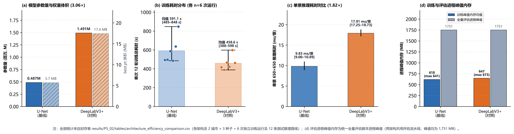
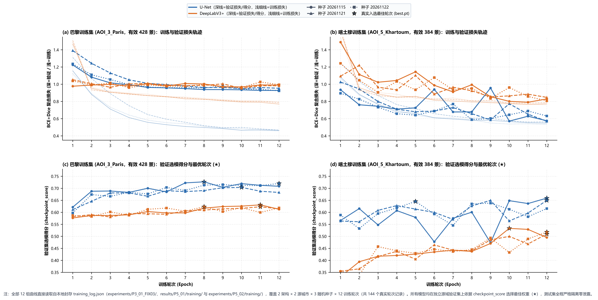

# 补充材料与复现说明

@authors Mengle Xue*
@affiliation 测绘地理信息学院；城市、邮政编码：[待填写]；ORCID：[待填写]

**所属论文**：跨城市建筑物提取误差的 GIS 统计后果与网格起点敏感性：SpaceNet 2 巴黎—喀土穆实证分析

本材料保留既有补充图S1—S3与表S1—S4，并完整收录从原正文移出的表S5—S15。表内实验值沿用整合稿；本次未新增训练、推理或统计实验。

---

## S1 模型复杂度、计算效率与内存资源对比（图 S1、表 S1）

为辅助正文第2.3和3.1节说明 U-Net 与 DeepLabV3+ 属于不同容量配置下的架构族稳健性对照，图 S1 与表 S1 报告了在统一 CPU 4 线程确定性计算环境下（`DataLoader workers=0`）两类模型全部 12 次训练运行与 24 条测试推理路线的实测资源开销。数据显示，尽管 DeepLabV3+ 可训练参数量（`1,490,689`）与最优权重体积（`17.42 MB`）约为 U-Net（`486,553`，`5.69 MB`）的 3.06 倍，其单次 12 轮完整训练平均耗时（`458.6 s`）反而略短于 U-Net（`591.1 s`），这与 MobileNetV2-0.5 深度可分离卷积及 `output_stride=16` 下较小的中高层特征图分辨率有关；但在面向原生 `650×650` 上采样推理阶段，DeepLabV3+ 单景耗时（`17.91 ms/景`）为 U-Net（`9.83 ms/景`）的 1.82 倍。两架构训练进程峰值内存接近（均值 `618.1 MB` vs `646.8 MB`），评估进程峰值内存（`1,751.1 MB`）源于共用同一全量 GIS/指标评估流水线。

@figure S1 U-Net 与 DeepLabV3+ 在 CPU 4 线程确定性环境下的模型参数量、权重体积、12 轮训练耗时、单景推理耗时与进程峰值内存对比

@table S1 两类语义分割架构计算复杂度与实测运行效率明细（来源：`results/P5_02/tables/architecture_efficiency_comparison.csv`）

| 架构 | 可训练参数量 | 最优权重体积 (MB) | 12 轮训练总耗时均值 [范围] (s) | 单景推理耗时均值 [范围] (ms) | 训练峰值内存均值 (MB) | 评估进程峰值内存 (MB) |
| :--- | :---: | :---: | :---: | :---: | :---: | :---: |
| UNet | 486,553 | 5.69 | 591.1 [485.1–847.7] | 9.83 [9.00–10.89] | 618.1 (max 640.5) | 1751.1 |
| DeepLabV3Plus | 1,490,689 | 17.42 | 458.6 [388.0–597.9] | 17.91 [17.25–18.73] | 646.8 (max 672.6) | 1751.1 |

---

## S2 完整 27 种阈值敏感性情景矩阵与非嵌套零抵消误差预算（图 S2、表 S2）

正文第2.5和3.3节聚焦主情景（$E_{\mathrm{net}}\le 2\%$、$E_{\mathrm{spatial}}\le 5\%$、$Q\ge 50\%$）。为全面检验双误差诊断结论对容忍阈值与支持度门槛的敏感性，图 S2 完整呈现了封存表 `results/P5_03/tables/all_288_27_scenarios.csv`（总计 `38,880` 条五分层情景记录，其中全观测域分层 `stratum='all'` 含 `288 × 27 = 7,776` 条）在 9 组误差容忍组合与 3 档支持度门槛（$Q\ge 20\%, 50\%, 80\%$）下的 27 情景矩阵。

结果显示两项关键机制：（1）隐蔽高风险面积占比（`hidden_area_fraction_total`）对误差阈值 $(\tau_{\mathrm{net}},\tau_{\mathrm{spatial}})$ 呈平滑单调响应，在全部嵌套组合下喀土穆同城 D 均高于巴黎同城 A，且 500 m 尺度持续高于 100 m；（2）支持度门槛 $Q_{\min}$ 直接主导联合通过率（图 S2e、f），在 500 m 尺度下因全部 64 格均为部分覆盖（$Q$ 中位数 26.1%），当门槛提升至 $Q\ge 80\%$ 时联合通过率几乎降为 `0.0%–0.5%`。表 S2 进一步列出 288 组运行在 $Q\ge 50\%$ 下跨 9 组误差阈值的零抵消纯单边错误格计数，证实全部 **1,958** 个纯 FP/FN 零抵消标记格（原补充叙述为12.78%，原表S2为12.80%；两处不一致，本次均保留原记载，待作者核定）均集中在非嵌套组合（$E_{\mathrm{net}}\le 5\%, E_{\mathrm{spatial}}\le 2\%$），而在全部 8 组嵌套组合中零抵消格严格为 `0`。

@figure S2 27 种误差与观测支持阈值组合在双城多尺度下的隐蔽高风险面积占比与联合通过率敏感性矩阵（蓝框★为主情景）

@table S2 全部 288 组实验在 9 组误差容忍阈值（$Q\ge 50\%$）下的标记网格总数与零抵消纯单边错误格统计

| 净误差容忍阈值 | 空间错分容忍阈值 | 阈值类型 | 288 组累计标记格数 | 其中零抵消纯 FP/FN 格数 | 零抵消占比 |
| :---: | :---: | :---: | :---: | :---: | :---: |
| $E_{\mathrm{net}}\le 1\%$ | $E_{\mathrm{spatial}}\le 2\%$ | 嵌套 | 3,247 | 0 | 0.00% |
| $E_{\mathrm{net}}\le 1\%$ | $E_{\mathrm{spatial}}\le 5\%$ | 嵌套 | 1,969 | 0 | 0.00% |
| $E_{\mathrm{net}}\le 1\%$ | $E_{\mathrm{spatial}}\le 10\%$ | 嵌套 | 1,184 | 0 | 0.00% |
| $E_{\mathrm{net}}\le 2\%$ | $E_{\mathrm{spatial}}\le 2\%$ | 嵌套 | 6,489 | 0 | 0.00% |
| $E_{\mathrm{net}}\le 2\%$ | $E_{\mathrm{spatial}}\le 5\%$ | 主情景★ | 3,932 | 0 | 0.00% |
| $E_{\mathrm{net}}\le 2\%$ | $E_{\mathrm{spatial}}\le 10\%$ | 嵌套 | 2,381 | 0 | 0.00% |
| $E_{\mathrm{net}}\le 5\%$ | $E_{\mathrm{spatial}}\le 2\%$ | 非嵌套 | 15,300 | 1,958 | 12.80% |
| $E_{\mathrm{net}}\le 5\%$ | $E_{\mathrm{spatial}}\le 5\%$ | 嵌套 | 9,258 | 0 | 0.00% |
| $E_{\mathrm{net}}\le 5\%$ | $E_{\mathrm{spatial}}\le 10\%$ | 嵌套 | 5,640 | 0 | 0.00% |

---

## S3 全 12 次独立模型训练损失与源域验证选模过程（图 S3、表 S3）

为完整呈现全部 2 架构 × 2 源城市 × 3 随机种子（共 12 次独立训练 × 12 轮 = 144 个真实轮次）的优化收敛与无泄露选模过程，图 S3 与表 S3 直接整理自本地封存的 12 份 `training_log.json`。所有模型在 12 轮固定训练预算内均平稳收敛、未出现梯度爆炸或发散；两座城市上 U-Net 的验证选模综合得分（`checkpoint_score`）持续高于 DeepLabV3+，与正文报告的同城精度差异方向一致；其成因尚未经单因素消融识别。

@figure S3 全 12 次独立训练运行（U-Net 与 DeepLabV3+，两城×三种子）的 BCE+Dice 训练/验证损失轨迹与源域验证选模得分（★标出真实入选 `best.pt` 轮次）

@table S3 全 12 次真实模型训练的最佳轮次、验证选模得分及实测耗时汇总

| 架构 | 源城市 | 随机种子 | 最佳轮次 | 最佳验证得分 | 最佳轮训练损失 | 最佳轮验证损失 | 12 轮总耗时 (s) |
| :--- | :--- | :---: | :---: | :---: | :---: | :---: | :---: |
| U-Net | 巴黎 (AOI_3_Paris) | `20261115` | 8 / 12 | 0.7269 | 0.4975 | 0.9378 | 493.7 |
| U-Net | 喀土穆 (AOI_5_Khartoum) | `20261115` | 12 / 12 | 0.6590 | 0.5487 | 0.5755 | 497.4 |
| U-Net | 巴黎 (AOI_3_Paris) | `20261121` | 10 / 12 | 0.7039 | 0.4981 | 0.9491 | 586.2 |
| U-Net | 喀土穆 (AOI_5_Khartoum) | `20261121` | 12 / 12 | 0.6497 | 0.5625 | 0.5699 | 485.0 |
| U-Net | 巴黎 (AOI_3_Paris) | `20261122` | 12 / 12 | 0.7202 | 0.4577 | 0.9226 | 636.0 |
| U-Net | 喀土穆 (AOI_5_Khartoum) | `20261122` | 5 / 12 | 0.6453 | 0.6398 | 0.6403 | 847.5 |
| DeepLabV3+ | 巴黎 (AOI_3_Paris) | `20261115` | 11 / 12 | 0.6310 | 0.7901 | 0.9912 | 415.8 |
| DeepLabV3+ | 喀土穆 (AOI_5_Khartoum) | `20261115` | 10 / 12 | 0.5331 | 0.7761 | 0.8012 | 387.9 |
| DeepLabV3+ | 巴黎 (AOI_3_Paris) | `20261121` | 11 / 12 | 0.6229 | 0.8023 | 0.9831 | 466.0 |
| DeepLabV3+ | 喀土穆 (AOI_5_Khartoum) | `20261121` | 12 / 12 | 0.5094 | 0.7866 | 0.8473 | 421.2 |
| DeepLabV3+ | 巴黎 (AOI_3_Paris) | `20261122` | 8 / 12 | 0.6231 | 0.8348 | 0.9980 | 597.7 |
| DeepLabV3+ | 喀土穆 (AOI_5_Khartoum) | `20261122` | 12 / 12 | 0.5176 | 0.7614 | 0.8069 | 461.8 |

---

## S4 MAUP 原始起点零隐蔽例平移反转反例明细（表 S4）

配合正文第3.4节与图 5(c)，表 S4 完整列出全部 72 组四起点比较组中，21 组原始起点主情景标记格数为 0 里经半格平移后翻转为非零反例的 **8 组**详细记录（全部位于巴黎 A/C 路线，单次最高跳变至 3 格、对应隐蔽面积占比最高 `1.93%`）。其余 13/21 组在全部 4 个离散起点均恒维持 0 格。

@table S4 原始起点零隐蔽例经半格平移后翻转为非零反例的 8 组完整明细（来源：`results/P5_03/tables/zero_hidden_origin_stability.csv`）

| 架构 | 城市 / 路线 | 随机种子 | 尺度 | 四起点隐蔽格数（原 / 东移 / 北移 / 对角） | 平移后最大隐蔽面积占比 |
| :--- | :---: | :---: | :---: | :---: | :---: |
| DeepLabV3Plus | 巴黎 / C | `20261121` | 100 m | 0 / 1 / 0 / 0 | 0.05% |
| DeepLabV3Plus | 巴黎 / C | `20261115` | 250 m | 0 / 1 / 0 / 0 | 0.51% |
| UNet | 巴黎 / A | `20261121` | 250 m | 0 / 3 / 0 / 1 | 1.93% |
| UNet | 巴黎 / A | `20261115` | 500 m | 0 / 0 / 0 / 1 | 0.43% |
| UNet | 巴黎 / A | `20261122` | 500 m | 0 / 1 / 0 / 0 | 0.03% |
| UNet | 巴黎 / C | `20261115` | 100 m | 0 / 1 / 0 / 0 | 0.05% |
| UNet | 巴黎 / C | `20261121` | 100 m | 0 / 1 / 0 / 0 | 0.05% |
| UNet | 巴黎 / C | `20261122` | 100 m | 0 / 1 / 0 / 0 | 0.05% |

## S5 原正文完整表格档案

以下表S5—S15依次对应整合稿表1—11，保留原表逐单元格内容；表题作期刊式简化。正文中的精简表不能替代这些完整记录。原文引文数字在本补充材料中按新版对应关系转换；新旧文献编号映射见改版记录。

@table S5 研究区概况、影像元数据与有效样本流向
| 数据层面 | 巴黎（`AOI_3_Paris`） | 喀土穆（`AOI_5_Khartoum`） | 核验依据与说明 |
| :--- | :---: | :---: | :--- |
| 官方 AOI 面积 / 官方标签数 | 约 1,030 km² / 23,816 | 约 765 km² / 35,503 | SpaceNet 2 官方概况[6]，非有效样本数 |
| 本地资产总场景数 | 1,148 | 1,012 | `FIX03` 有效清单合计 2,160 景 |
| 质量排除（有效支持 <80%） | 144 | 262 | `excluded_quality`（不进入划分） |
| 通过质量筛选的候选场景 | 1,004 | 750 | 参与 500 m 空间块隔离划分 |
| 空间隔离 Buffer / 开发留出 / 单景排除 | 300 / 15 / 0 | 71 / 22 / 1（`img894`） | 不进入有效 Train/Val/Test |
| 有效 Train / Validation / Test | 428 / 150 / 111 | 384（P3-00 原 385）/ 141 / 131 | `img894` 由 FIX03 单独排除有效训练 |
| 实测输入影像规格 | `PS-RGB`，3 波段，`650×650`，`uint16` | `PS-RGB`，3 波段，`650×650`，`uint16` | `EPSG:4326`，`NoData=None` |
| 实测 WGS84 地面像元尺寸（东×北） | `0.1974–0.1976 m × 0.3003 m` | `0.2894–0.2896 m × 0.2988 m` | 步长 $2.7\times 10^{-6}\,^\circ$，纬向收缩显著 |

@table S6 空间划分、空间组与空标签构成
| 城市 | 有效 Train / Val / Test | 空间组数（Train / Val / Test） | 空标签场景数（Train / Val / Test） | 最小场景距离（Train–Val / Train–Test / Val–Test） |
| :--- | :---: | :---: | :---: | :---: |
| 巴黎 | 428 / 150 / 111 | 88 / 29 / 22 | 28 / 130 / 85 | `975.5 m` / `2,926.5 m` / `975.5 m` |
| 喀土穆 | 384 / 141 / 131 | 120 / 37 / 55 | 16 / 0 / 10 | `970.6 m` / `4,659.1 m` / `970.6 m` |

@table S7 双架构完整配置与训练超参数
| 配置项 | U-Net（基线架构） | DeepLabV3+（对照架构） | 共同冻结设置与说明 |
| :--- | :---: | :---: | :--- |
| 核心结构 | `init_features=8` 编码—解码跳接 | `MobileNetV2-0.5`；`OS=16`；`ASPP=(6,12,18)` | 3 通道输入、1 通道输出，均无预训练权重 |
| 可训练参数量 | 486,553（0.49M） | 1,490,689（1.49M） | 参数量比 3.06×（详见图 S1） |
| 输入预处理 | `128×128` RGB 双线性缩放 | `128×128` RGB 双线性缩放 | 标签最近邻缩放；支持掩膜自适应平均池化 $\ge 1-10^{-6}$ |
| 优化器与损失 | Adam（`lr=0.001`）；BCE+Dice（1:1） | Adam（`lr=0.001`）；BCE+Dice（1:1） | `batch_size=4`，12 epochs，无增强、无调度、无早停 |
| 随机种子 | `20261115`、`20261121`、`20261122` | `20261115`、`20261121`、`20261122` | 共 12 次独立训练（轨迹见图 S3） |
| 计算环境 | CPU 4 线程确定性模式 | CPU 4 线程确定性模式 | `DataLoader workers=0`，全程可复现 |

@table S8 原始起点网格与观测支持
| 城市（UTM 投影） | 网格尺度 | 有效网格数 | 部分覆盖网格数（占比） | 观测支持比例 $Q$ 中位数 |
| :--- | :---: | :---: | :---: | :---: |
| 巴黎（`EPSG:32631`） | 100 m | 420 | 306（72.9%） | 0.7891 |
| 巴黎（`EPSG:32631`） | 250 m | 94 | 94（100.0%） | 0.4909 |
| 巴黎（`EPSG:32631`） | 500 m | 30 | 30（100.0%） | 0.3619 |
| 喀土穆（`EPSG:32636`） | 100 m | 781 | 568（72.7%） | 0.6403 |
| 喀土穆（`EPSG:32636`） | 250 m | 193 | 189（97.9%） | 0.3247 |
| 喀土穆（`EPSG:32636`） | 500 m | 64 | 64（100.0%） | 0.2606 |

@table S9 基线U-Net源域验证
| 源城市 | Train / Val 景数 | 最佳轮次 | 总更新步数 | 验证选模得分 $S$ | Micro IoU (%) | Precision (%) | Recall (%) | F1 (%) | 非空 Macro IoU (%) |
| :--- | :---: | :---: | :---: | :---: | :---: | :---: | :---: | :---: | :---: |
| 巴黎 | 428 / 150 | 8 / 12 | 1,284 | 0.7269 | 54.46 | 72.67 | 68.48 | 70.51 | 51.75 |
| 喀土穆 | 384 / 141 | 12 / 12 | 1,152 | 0.6590 | 65.84 | 75.66 | 83.53 | 79.40 | 64.97 |

@table S10 基线U-Net四路线像元精度
| 路线 | 源城市→目标城市 | Test 场景 / 空间组 | Micro IoU (%) | Precision (%) | Recall (%) | F1 (%) | 非空 Macro IoU (%) | 空景 FP 像元 |
| :---: | :--- | :---: | :---: | :---: | :---: | :---: | :---: | :---: |
| A | 巴黎→巴黎 | 111 / 22 | 50.00 | 73.57 | 60.95 | 66.67 | 41.31 | 3,649（85 景） |
| B | 巴黎→喀土穆 | 131 / 55 | 6.81 | 63.84 | 7.08 | 12.75 | 4.57 | 358（10 景） |
| C | 喀土穆→巴黎 | 111 / 22 | 0.09 | 4.76 | 0.09 | 0.19 | 0.05 | 2,640（85 景） |
| D | 喀土穆→喀土穆 | 131 / 55 | 52.42 | 70.95 | 66.75 | 68.79 | 46.57 | 0（10 景） |

@table S11 基线U-Net三尺度GIS误差与抵消率
| 城市 / 路线 | 尺度 (m) | 有效网格数 | 覆盖率 MAE (pp) | 面积加权 MAE (pp) | 面积加权有符号偏差 (pp) | 相对 GT 面积偏差 (%) | 汇总格内抵消率 (%) |
| :--- | :---: | :---: | :---: | :---: | :---: | :---: | :---: |
| 巴黎 / A | 100 | 420 | 0.31 | 0.29 | −0.19 | −17.16 | 58.10 |
| 巴黎 / C | 100 | 420 | 1.04 | 1.13 | −1.10 | −98.01 | 1.21 |
| 巴黎 / A | 250 | 94 | 0.38 | 0.25 | −0.19 | −17.16 | 63.98 |
| 巴黎 / C | 250 | 94 | 1.24 | 1.12 | −1.10 | −98.01 | 2.73 |
| 巴黎 / A | 500 | 30 | 0.30 | 0.25 | −0.19 | −17.16 | 64.01 |
| 巴黎 / C | 500 | 30 | 1.28 | 1.10 | −1.10 | −98.01 | 3.72 |
| 喀土穆 / D | 100 | 781 | 4.24 | 3.77 | −0.78 | −5.93 | 52.64 |
| 喀土穆 / B | 100 | 781 | 12.63 | 12.32 | −11.69 | −88.90 | 3.28 |
| 喀土穆 / D | 250 | 193 | 3.59 | 2.95 | −0.78 | −5.93 | 62.91 |
| 喀土穆 / B | 250 | 193 | 12.27 | 12.05 | −11.69 | −88.90 | 5.44 |
| 喀土穆 / D | 500 | 64 | 2.82 | 2.70 | −0.78 | −5.93 | 66.06 |
| 喀土穆 / B | 500 | 64 | 10.99 | 11.76 | −11.69 | −88.90 | 7.70 |

@table S12 基线U-Net主情景双误差诊断与低支持网格
| 目标 / 路线 | 尺度 (m) | 总网格数 | 净误差通过格 | 其中空间超限格 | 占通过格比例 (%) | 占总观测面积 (%) | 低支持格数 ($Q<0.5$) |
| :--- | :---: | :---: | :---: | :---: | :---: | :---: | :---: |
| 巴黎 / A | 100 | 420 | 401 | 6 | 1.50 | 2.14 | 139 |
| 巴黎 / A | 250 | 94 | 89 | 2 | 2.25 | 2.25 | 48 |
| 巴黎 / A | 500 | 30 | 29 | 0 | 0.00 | 0.00 | 18 |
| 巴黎 / C | 100 / 250 / 500 | 420 / 94 / 30 | 377 / 81 / 25 | 0 / 0 / 0 | 0.00 | 0.00 | 139 / 48 / 18 |
| 喀土穆 / D | 100 | 781 | 457 | 77 | 16.85 | 12.10 | 323 |
| 喀土穆 / D | 250 | 193 | 120 | 26 | 21.67 | 17.31 | 128 |
| 喀土穆 / D | 500 | 64 | 42 | 10 | 23.81 | 25.61 | 56 |
| 喀土穆 / B | 100 | 781 | 313 | 5 | 1.60 | 0.58 | 323 |
| 喀土穆 / B | 250 | 193 | 72 | 4 | 5.56 | 2.86 | 128 |
| 喀土穆 / B | 500 | 64 | 22 | 1 | 4.55 | 3.72 | 56 |

@note 标记不以Q筛选；低支持另列，联合通过才要求Q≥50%。统计值与原表一致。

@table S13 U-Net逐种子四路线结果
| 随机种子 | 路线 | Micro IoU (%) | Precision (%) | Recall (%) | F1 (%) | 有符号覆盖偏差 (pp) | 相对 GT 面积偏差 (%) | 全域 $E_{\mathrm{spatial}}$ (%) |
| :---: | :---: | :---: | :---: | :---: | :---: | :---: | :---: | :---: |
| 20261115 | A | 50.00 | 73.57 | 60.95 | 66.67 | −0.19 | −17.16 | 0.69 |
| 20261115 | B | 6.81 | 63.84 | 7.08 | 12.75 | −11.69 | −88.90 | 12.74 |
| 20261115 | C | 0.09 | 4.76 | 0.09 | 0.19 | −1.10 | −98.01 | 1.15 |
| 20261115 | D | 52.42 | 70.95 | 66.75 | 68.79 | −0.78 | −5.93 | 7.96 |
| 20261121 | A | 45.65 | 73.65 | 54.56 | 62.68 | −0.29 | −25.92 | 0.73 |
| **20261121** | **B** | **22.60** | **29.86** | **48.19** | **36.87** | **+8.07** | **+61.38** | **21.69** |
| 20261121 | C | 0.22 | 9.00 | 0.23 | 0.44 | −1.10 | −97.49 | 1.15 |
| 20261121 | D | 48.59 | 74.94 | 58.02 | 65.40 | −2.97 | −22.58 | 8.07 |
| 20261122 | A | 50.15 | 71.83 | 62.43 | 66.80 | −0.15 | −13.08 | 0.70 |
| 20261122 | B | 7.27 | 39.27 | 8.19 | 13.55 | −10.40 | −79.14 | 13.74 |
| 20261122 | C | 0.12 | 14.80 | 0.13 | 0.25 | −1.12 | −99.15 | 1.13 |
| 20261122 | D | 50.11 | 70.39 | 63.50 | 66.77 | −1.29 | −9.80 | 8.31 |

@table S14 双架构三种子描述性汇总
| 路线 | 架构 | IoU 均值±SD (%) | IoU 范围 (%) | Precision 均值 (%) | Recall 均值 (%) | F1 均值 (%) | 相对 GT 面积偏差范围 (%) |
| :---: | :--- | :---: | :---: | :---: | :---: | :---: | :---: |
| A | U-Net | 48.60 ± 2.56 | 45.65–50.15 | 73.01 | 59.31 | 65.38 | −25.92 至 −13.08 |
| A | DeepLabV3+ | 28.19 ± 2.54 | 25.73–30.80 | 47.62 | 40.96 | 43.94 | −21.54 至 −1.76 |
| B | U-Net | 12.23 ± 8.99 | 6.81–22.60 | 44.32 | 21.15 | 21.06 | −88.90 至 +61.38 |
| B | DeepLabV3+ | 18.41 ± 9.61 | 7.43–25.28 | 29.61 | 35.94 | 30.31 | −59.98 至 +88.42 |
| C | U-Net | 0.15 ± 0.07 | 0.09–0.22 | 9.52 | 0.15 | 0.29 | −99.15 至 −97.49 |
| C | DeepLabV3+ | 0.11 ± 0.01 | 0.10–0.11 | 7.58 | 0.11 | 0.21 | −99.04 至 −97.20 |
| D | U-Net | 50.38 ± 1.93 | 48.59–52.42 | 72.10 | 62.75 | 66.99 | −22.58 至 −5.93 |
| D | DeepLabV3+ | 40.66 ± 0.99 | 39.68–41.66 | 64.66 | 52.38 | 57.81 | −26.48 至 −14.24 |

@table S15 img1028双架构逐种子单景结果
| 路线 / 架构 / 种子 | IoU (%) | Precision (%) | Recall (%) | F1 (%) | FP 面积 (m²) | FN 面积 (m²) |
| :--- | :---: | :---: | :---: | :---: | :---: | :---: |
| B / U-Net / 20261115 | 6.46 | 9.44 | 16.98 | 12.13 | 6,197.94 | 3,157.86 |
| **B / U-Net / 20261121** | **11.89** | **12.44** | **72.92** | **21.25** | **19,527.83** | **1,030.02** |
| B / U-Net / 20261122 | 3.31 | 5.03 | 8.85 | 6.41 | 6,352.48 | 3,467.30 |
| D / U-Net / 20261115 | 36.07 | 45.40 | 63.71 | 53.02 | 2,914.07 | 1,380.45 |
| D / U-Net / 20261121 | 35.78 | 45.36 | 62.89 | 52.70 | 2,881.81 | 1,411.76 |
| D / U-Net / 20261122 | 30.00 | 36.42 | 62.98 | 46.15 | 4,182.09 | 1,408.21 |
| B / DeepLabV3+ / 20261115 | 11.72 | 13.05 | 53.36 | 20.97 | 13,520.75 | 1,774.13 |
| B / DeepLabV3+ / 20261121 | 8.70 | 20.13 | 13.30 | 16.01 | 2,006.93 | 3,298.05 |
| B / DeepLabV3+ / 20261122 | 12.99 | 15.36 | 45.67 | 22.99 | 9,572.87 | 2,066.70 |
| D / DeepLabV3+ / 20261115 | 20.86 | 25.80 | 52.10 | 34.51 | 5,698.84 | 1,821.86 |
| D / DeepLabV3+ / 20261121 | 29.05 | 40.93 | 50.03 | 45.02 | 2,746.55 | 1,900.91 |
| D / DeepLabV3+ / 20261122 | 24.59 | 32.85 | 49.42 | 39.47 | 3,842.38 | 1,923.83 |

## S6 方法细节与本地复现索引

以下信息用于复现定位，未据此重算实验。原始完整稿及核验报告保存在paper/P6_integrated_v2/，本次只读。

有效清单为configs/P3_01_FIX03_effective_manifest.csv，原稿记录SHA256前8位3e9b55bd。训练与推理资产分别位于experiments/P3_01_FIX03/、results/P5_01/、experiments/P5_02/、results/P5_02/；四起点结果位于results/P5_03/。字母路线与种子含义沿用正文。

有效掩膜采用P1_01_v1规则：联合检查RGB、PAN、MUL-PanSharpen和原生MUL的零值连通组件，边缘四邻接组件不少于64像元，内蚀2像元后原生MUL全波段零值一致率不低于99%，并结合源内部掩膜。类别0为支持的边缘填充，类别1为保守有效支持，类别2为边界缓冲或产品间不一致像元，类别3为源掩膜无效像元；仅类别1进入训练与评价。含糊边缘样本AOI_5_Khartoum_img894从有效训练排除。

巴黎的空间切线为UTM北坐标5,430,500 m和5,432,500 m；喀土穆为1,728,000 m和1,731,500 m。切线两侧各100 m缓冲；验证条带间距分别2.0 km和3.5 km。归一化按image_id排序，对训练有效像元每隔16像元行优先采样；分位数见正文。数据读取工作进程数为0，验证选模规则标识为group_balanced_strata_iou_v1。

去重UTM观测支持的最大总面积守恒残差为3.23×10⁻⁵ m²。原生逐景像元统计含各景有效区域，唯一UTM面积统计对重叠去重；两类分母不得互换。

双误差的分类与汇总代码为scripts/P4_02_diagnose.py，其中hidden_spatial_error=net_pass & ~spatial_pass，support_low单独记录，joint_scenario_pass额外要求支持充分。主情景原始汇总位于results/P4_02/tables/main_scenario_summary.csv；四起点完整主情景为results/P5_03/tables/all_288_main_scenario.csv。27种情景的38,880条记录含五个分层；全观测域all层为7,776条，不能把五分层记录理解为独立实验重复。

本地计算资源表为results/P5_02/tables/architecture_efficiency_comparison.csv。MAUP零例记录为results/P5_03/tables/zero_hidden_origin_stability.csv。五张主图及三张补充图从整合稿复制，字节校验见本版本_work/quality_checks.json；原图PDF、SVG仍保留在原目录。

正文九个编号公式由原稿四个公式块拆分排版，数学定义未变。为便于逐项核查，原始LaTeX表达式归档于_work/original_equations.json。公开仓库和长期归档地址仍待作者提供。

作者说明：唯一作者、第一作者及通讯作者为 Mengle Xue（薛梦乐）。通信邮箱：[待填写；公开版省略]；ORCID：[待填写]。英文姓名拼写正式发表前由作者核定。
